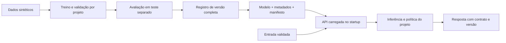

# Arquitetura e decisões

Os oito laboratórios compartilham infraestrutura pequena e explícita. Cada projeto mantém seus dados, regras de decisão e transformação de features. Nenhum módulo de domínio importa FastAPI ou inicia uma API ao ser importado.

## Responsabilidades

| Camada | Arquivos | Responsabilidade |
| --- | --- | --- |
| Dados e features | Cada projeto: data, features, engine | Dados locais, contratos e transformação consistente |
| Treino | train ou mlops/pipeline | Divisão dos dados, ajuste, escolha da política, avaliação e registro |
| Inferência | inference, forecast ou cascade | Previsão e decisão sem dependência de HTTP |
| HTTP | Cada projeto: api | Entrada e saída Pydantic, códigos HTTP e chamadas ao domínio |
| Ciclo de vida HTTP | serving | Carregamento de uma versão no startup, health e validação JSON |
| Registro local | shared | Gravação, verificação de integridade, versão explícita e promoção |
| Avaliação tabular | evaluation e tabular | Métricas, políticas de limiar, calibração e coeficientes |
| Uso local | __main__ | Comandos explícitos de treino, serviço, monitoramento e versões |

As funções train() retornam o caminho da versão e os metadados. Os comandos tradicionais de cada módulo continuam disponíveis. A CLI central usa as mesmas funções, sem duplicar os fluxos de treinamento.

## Divisão dos dados e políticas

Churn, fraude e manutenção usam 60% para treino, 20% para validação e 20% para teste, com estratificação. Os classificadores usam pesos por classe; uma calibração sigmoide baseada em predições de três folds do treino corrige a interpretação das probabilidades. A validação escolhe o limiar do modelo que será publicado. O modelo não é retreinado depois dessa escolha. O teste permanece fora do ajuste e da seleção do limiar.

Os coeficientes globais explicam os logits do classificador linear subjacente. Eles não explicam individualmente cada cliente ou equipamento nem são os coeficientes da transformação de calibração.

Suporte divide famílias de frases por intenção. As variações de uma mesma frase ficam na mesma partição; mudar apenas o contexto da frase não cria um exemplo independente de avaliação. Os dois estágios ajustam seus limiares na validação e podem ser desativados quando não há acurácia e amostra suficientes. Vocabulário desconhecido encaminha para revisão humana. Os escores de confiança desses estágios não são probabilidades calibradas de correção.

Visão pré-treina em um domínio e adapta em outro. Os dados do domínio alvo são separados antes da adaptação. Os checkpoints não atualizam a versão corrente. Só a cascata completa é promovida automaticamente. A quantização reduz a precisão dos pixels de entrada; o exemplo não implementa quantização dos pesos nem demonstra aceleração em hardware.

Demanda separa o tempo cronologicamente e registra avaliações de uma hora e de 24 horas. No cenário recursivo, cada previsão alimenta a próxima janela; valores reais futuros não entram nesse horizonte. Uma nova origem do backtest pode usar os dados observados até aquele instante, como ocorreria em operação.

Sensores separa as leituras brutas cronologicamente antes de construir janelas. Assim, uma leitura não pertence a janelas de duas partições diferentes. Uma janela é anômala quando contém qualquer leitura marcada como anômala; o alerta pode permanecer até essa leitura sair da janela. Só janelas completamente normais ajustam o detector e a referência. A mesma transformação vetorizada calcula as features em lote e em inferência.

Recomendação separa uma interação por usuário e mantém pelo menos uma interação em treino. Embeddings, afinidades, popularidade e exclusão de itens já vistos usam apenas as interações de treino. O ranking combina escores com pesos heurísticos explícitos; esses pesos não foram aprendidos nem otimizados no teste. Busca sem correspondência lexical retorna lista vazia. Usuários desconhecidos geram 404 individualmente ou um erro por ID em lote.

## Registro e promoção

Cada versão recebe um identificador com horário UTC e componente aleatório. A gravação começa em um diretório temporário dentro do registro. Modelo, metadados e documentos adicionais são escritos antes de um manifesto SHA-256. O diretório completo é renomeado para a versão final; somente então um arquivo temporário exclusivo substitui latest.json atomicamente.

Falhas anteriores à promoção preservam a versão corrente. Escritas concorrentes têm arquivos temporários diferentes: a última promoção concluída determina a versão corrente. Isso não representa um controle de concorrência distribuído nem uma garantia de persistência após perda de energia. Uma falha após completar uma versão e antes de promover pode deixar uma versão válida não promovida.

O carregamento verifica o manifesto, o projeto, a versão do esquema, o identificador e a versão de scikit-learn antes da desserialização. O checksum detecta corrupção acidental; não autentica um artefato de terceiros. Arquivos joblib devem vir de um registro local confiável, porque a desserialização pode executar código. Artefatos antigos sem o novo manifesto precisam ser retreinados.

Uma API mantém a versão carregada no início do processo. Promover outro modelo não muda o modelo de um processo já iniciado. Reinicie a API ou inicie um novo processo com --model-version para selecionar a versão desejada. O monitor de sensores mantém sua janela em uma instância local; um sistema com múltiplos processos precisaria de estado compartilhado externo.

## Critério de manutenção

Contratos de entrada rejeitam campos extras, valores não finitos, IDs vazios e limites inválidos. As respostas têm modelos explícitos no OpenAPI. Falhas de validação retornam 422 sem repetir entradas que não podem ser serializadas em JSON.

Os testes verificam invariantes: integridade e promoção do registro, concorrência, preservação da versão após falha, ausência de sobreposição entre famílias de frases, igualdade entre features de lote e fluxo, uso recursivo de previsões, políticas de abstinência e APIs com modelos realmente treinados. Ruff verifica os arquivos de aplicação e teste. O CI executa a mesma suíte em Python 3.11 e 3.14 e constrói os pacotes.

Os laboratórios continuam educacionais e usam dados sintéticos. Resultados de teste desses dados não estabelecem desempenho em dados reais. A evidência da execução local está em validation.md.
